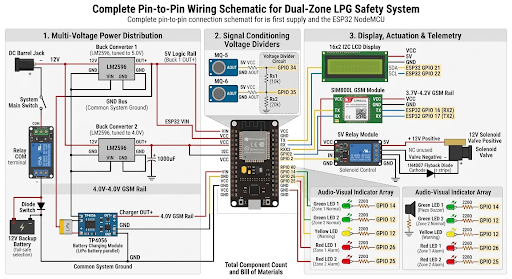

# IoT-Based Dual-Zone LPG Leakage Detection & Automated Mitigation System

An advanced, automated dual-zone Liquefied Petroleum Gas (LPG) leakage detection and mitigation system powered by an **ESP32 microcontroller**, custom **C++ firmware**, and integrated safety hardware. Designed as a reliable, real-time safety solution to prevent domestic and industrial gas-related hazards.

---

## 🚀 Key Features
* **Dual-Zone Monitoring:** Continuous gas concentration tracking across two distinct zones using MQ-5/MQ-6 gas sensors.
* **Immediate Local Alerts:** Synchronized local warning mechanisms featuring active buzzers and high-visibility LED indicators upon threshold breach.
* **Automated Mitigation:** Instant activation of solenoid valve actuators to physically cut off the gas supply line and prevent potential disasters.
* **Remote GSM Notifications:** Automated SMS alerts dispatched via a connected GSM module to notify users or facility managers instantly.
* **Embedded C Firmware:** Robust, low-latency control logic programmed in C++ for stable, real-time microcontroller operation.

---

## 🛠️ Hardware Components & Tech Stack
* **Microcontroller:** ESP32 (Wi-Fi and Bluetooth-enabled MCU)
* **Sensors:** MQ-5 / MQ-6 Gas Sensors (LPG, Propane, and Butane detection)
* **Actuators & Output Devices:** Solenoid Valve (Automatic shutoff), Active Buzzer, LEDs
* **Communication Module:** GSM SIM Module (for remote SMS alerts)
* **Language & Environment:** C++ / Arduino IDE

---

## 🔌 System Architecture & Workflow
1. **Sensing:** The MQ sensors continuously measure air quality and gas concentration levels across dual zones, feeding analog data into the ESP32 GPIO pins.
2. **Evaluation:** The onboard C++ firmware evaluates real-time data against pre-calibrated threshold values.
3. **Mitigation & Alert:** 
   * If a leak is detected, the ESP32 immediately triggers local audio-visual alerts (buzzer/LEDs).
   * Simultaneously, it sends an emergency command to close the solenoid valve and fires a GSM text message to designated numbers.

---

## 📂 Repository Structure
```text
├── firmware/
│   └── main.ino          # Core C++ code running on the ESP32
├── schematics/
│   └── circuit-diagram.png # Hardware wiring and schematic layout
└── README.md             # Project documentation


